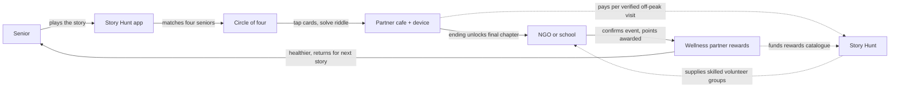

# Story Hunt workflow

Every senior holds one piece of a story, and the story only ends when four of them meet.

The thread that ties it together is **skill → story → deed**: the skill a senior picks at sign-up chooses their story, the story is solved together at a café, and it ends by passing that skill on to the community.

## Full flowchart

```mermaid
flowchart TD
    subgraph A["1. JOIN (app)"]
        A1["Senior installs the app"] --> A2["Chooses language"]
        A2 --> A3["Enters first name"]
        A3 --> A4["Picks skills<br/>cooking, gardening, sewing, teaching a language"]
        A4 --> A5["Picks interests<br/>coffee chats, walks, board games, heritage"]
        A5 --> A6["First skill selects the story<br/>cooking = The Lost Recipe"]
    end

    subgraph B["2. PLAY (app, 1 to 2 days, alone)"]
        B1["Day 1: story cards + match the pairs"] --> B2["Day 2: story cards + put steps in order"]
        B2 --> B3["Day 3: story cards + find the right picture"]
        B3 --> B4["Earns a piece of the story object each day"]
        B4 --> B5["Cliffhanger: your piece is only one quarter<br/>You receive ONE clue"]
    end

    subgraph C["3. MATCH (automatic)"]
        C1["System groups four seniors<br/>same story skill, same language where possible"]
        C1 --> C2{"Circle has four members?"}
        C2 -- "No" --> C3["App shows: finding your three neighbours"]
        C3 --> C2
        C2 -- "Yes" --> C4["App shows: time to meet your circle"]
    end

    subgraph D["4. MEET (partner cafe, 2 to 5 pm)"]
        D1["Senior picks a time slot in the app"] --> D2["Goes to the cafe with their card"]
        D2 --> D3["Taps card on the device"]
        D3 --> D4["Device greets by name and shows 1 of 4, 2 of 4, 3 of 4<br/>Each tap = one verified cafe visit"]
        D4 --> D5{"All four tapped?"}
        D5 -- "No" --> D6["Device waits and lists who is still to come"]
        D6 --> D3
        D5 -- "Yes" --> D7["Device asks the group riddle"]
    end

    subgraph E["5. BOND (at the cafe)"]
        E1["Four seniors share their clues and talk it through"] --> E2["Answer together on the red, yellow, green buttons"]
        E2 --> E3{"Correct?"}
        E3 -- "No" --> E4["Not quite: share your clues again"]
        E4 --> E1
        E3 -- "Yes" --> E5["Ending revealed on the device and in the app"]
        E5 --> E6["Each senior taps again and gives feedback<br/>good, okay, not good"]
        E6 --> E7["+100 points each<br/>Circle members become friends in the app"]
    end

    subgraph F["6. GIVE BACK (NGO or school)"]
        F1["The ending opens the final chapter<br/>a community event using the shared skill"]
        F1 --> F2["Example: teach a cooking class for children,<br/>teach Chinese, teach stitching"]
        F2 --> F3["Circle attends together for about one hour"]
        F3 --> F4["NGO confirms the visit on the dashboard"]
        F4 --> F5["+200 points each<br/>Story marked complete"]
    end

    subgraph G["7. REWARD AND REPEAT"]
        G1["Points redeemed only on fitness and wellness<br/>tai chi pass, health screening, swimming"]
        G1 --> G2["New story starts with the same circle"]
    end

    A6 --> B1
    B5 --> C1
    C4 --> D1
    D7 --> E1
    E7 --> F1
    F5 --> G1
    G2 -.-> B1
```

## Who is involved at each stage

## Stage by stage

| Stage | What happens | Where | Outcome for the senior | Outcome for partners |
|---|---|---|---|---|
| 1. Join | Language, name, skills, interests | App | A story chosen to fit their skill | Skill data for matching and events |
| 2. Play | Three short story days with one easy puzzle each | App, alone | A daily habit and one clue | None yet |
| 3. Match | Four seniors with the same story skill are grouped | Automatic | Three neighbours to meet | Coordinator sees why they were matched |
| 4. Meet | Pick a slot, go to the café, tap the card | Café device | A low-pressure reason to go out | Café gets a verified off-peak visit |
| 5. Bond | Combine clues, solve the riddle, give feedback | Café device | A ready-made conversation, three friends, 100 points | Feedback data per meet-up |
| 6. Give back | Community event using the shared skill | NGO or school | Purpose and recognition, 200 points | NGO gets a skilled volunteer group |
| 7. Reward and repeat | Redeem points, start the next story | App | Fitness and wellness rewards | Wellness partner reaches active seniors |

## How it supports holistic ageing

| Dimension | How Story Hunt addresses it |
|---|---|
| Social | A circle of four who meet in person and stay connected as friends |
| Mental | A daily story with simple puzzles |
| Purpose | Sharing a lifelong skill with children and the community |
| Physical | Points that can only be spent on fitness and wellness |

## Points

| Action | Points |
|---|---|
| Solving the story together at the café | 100 each |
| Completing the community event | 200 each |

## Status

- **Built and working:** every step above in the app, the browser version of the café device, and the dashboard.
- **Written but untested:** the firmware for the physical ESP32 device.
- **Demo placeholders:** the café, the NGO partners and the rewards are fictional, and the three story days can be played back to back.
- **Not built yet:** unlocking with three when one member does not show up.
